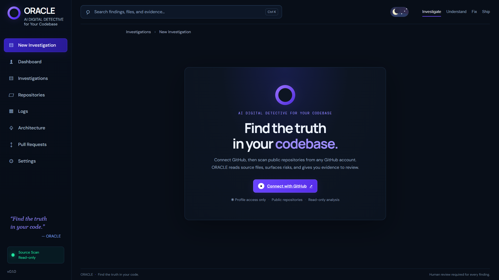
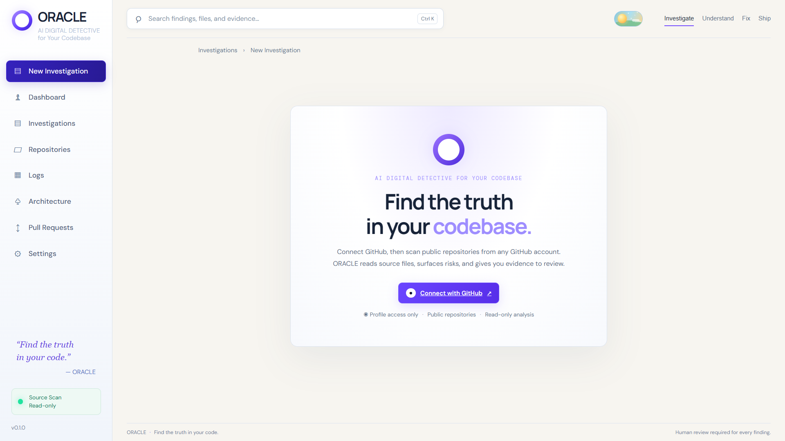
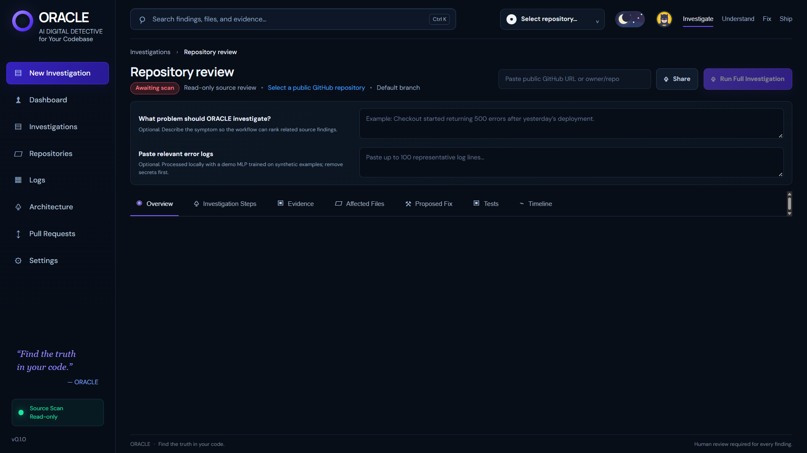
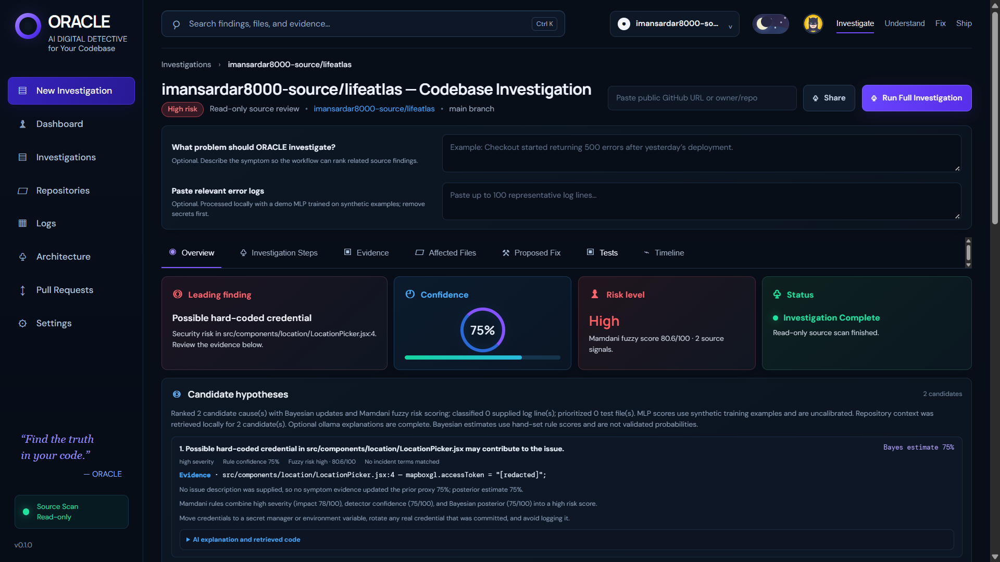
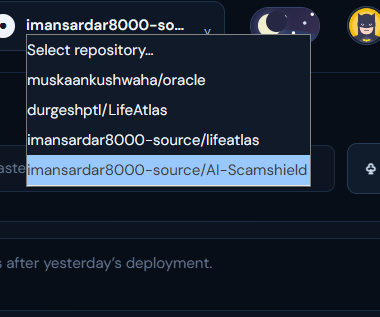
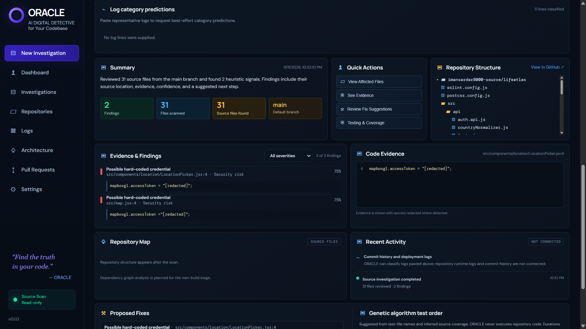
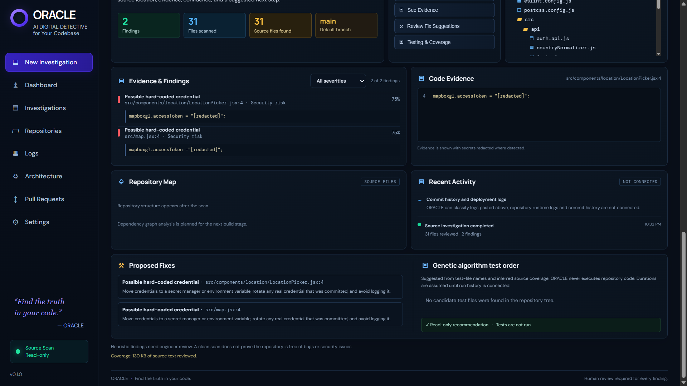
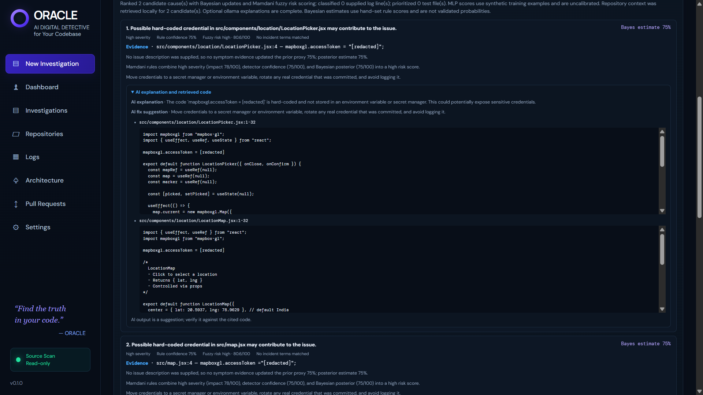
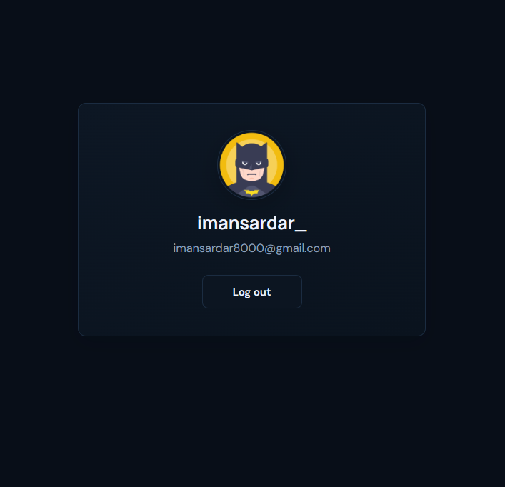
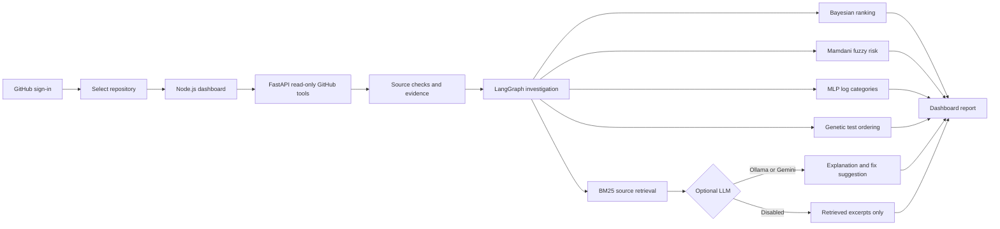

# ORACLE

<div align="center">

### Find the truth in your codebase.

**ORACLE** is a read-only GitHub repository investigator that combines explainable soft computing, source evidence, and optional retrieval-grounded AI explanations in one dashboard.

[](https://nodejs.org/)
[](https://www.python.org/)
[](https://fastapi.tiangolo.com/)
[](https://www.langchain.com/langgraph)
[](LICENSE)

[Explore the screenshots](#screenshots) · [Run locally](#run-locally) · [How it works](#how-it-works) · [Team](#team)

</div>

---

## At a glance

| | |
|---|---|
| **What it does** | Reviews repository source files and highlights possible bugs, security risks, and likely causes. |
| **What you get** | Ranked findings, confidence and risk details, cited code evidence, suggested fixes, and a test review order. |
| **AI options** | Local Ollama or hosted Gemini for optional explanations grounded in retrieved code. |
| **Safety** | Read-only GitHub analysis. ORACLE does not push commits, change repositories, or execute repository code or tests. |
| **Built with** | Node.js, FastAPI, LangGraph, Bayesian updating, Mamdani fuzzy inference, an MLP log classifier, a genetic algorithm, and BM25 retrieval. |

## Screenshots

### Connect GitHub

<table>
<tr>
<td width="50%"></td>
<td width="50%"></td>
</tr>
<tr><td align="center">GitHub sign-in · dark theme</td><td align="center">GitHub sign-in · light theme</td></tr>
</table>

### Investigate a repository

<table>
<tr>
<td width="50%"></td>
<td width="50%"></td>
</tr>
<tr><td align="center">Choose a repository and add optional context</td><td align="center">Review a completed source investigation</td></tr>
</table>

### Review findings and explanations

<table>
<tr>
<td width="50%"></td>
<td width="50%"></td>
</tr>
<tr><td align="center">Pick a repository</td><td align="center">See scan summary and repository context</td></tr>
<tr>
<td width="50%"></td>
<td width="50%"></td>
</tr>
<tr><td align="center">Inspect evidence and proposed fixes</td><td align="center">Expand AI explanation and retrieved source</td></tr>
</table>

### Account settings

<p align="center"></p>

## What ORACLE reports

- **Source findings:** heuristic checks identify suspicious code patterns and show file paths, line numbers, severity, confidence, and supporting evidence.
- **Candidate causes:** an explainable Bayesian update ranks possible causes using hand-set rule scores and available incident terms. These estimates are not calibrated probabilities.
- **Risk assessment:** Mamdani fuzzy rules combine impact, detector confidence, and posterior estimate into a review priority.
- **Log categories:** an optional one-hidden-layer MLP classifies pasted log lines. The bundled training examples are synthetic, so its scores are a demonstration and are not calibrated.
- **Test review order:** a genetic algorithm suggests an order for discovered tests using risk coverage and available duration data. ORACLE does not run the tests.
- **Retrieved context and AI:** local BM25 retrieval selects relevant source excerpts. If enabled, Ollama or Gemini can explain findings using those excerpts. Model output is advisory and should be checked against the cited code.

A clean scan does not prove that a repository is free of bugs or security issues. Treat every finding and suggested fix as a lead for an engineer to verify.

## How it works



## Technology stack

| Part | Technology | Role in ORACLE |
|---|---|---|
| Web interface and OAuth session | Node.js | Serves the dashboard, handles GitHub sign-in, and forwards authenticated analysis requests. |
| Repository tools and analysis API | FastAPI / Python | Reads repository metadata, source tree, and selected files through GitHub's API. |
| Investigation orchestration | LangGraph | Connects analysis, ranking, risk scoring, log classification, retrieval, and optional explanation steps. |
| Explainable cause ranking | Bayesian updating | Updates candidate cause estimates from rule evidence and incident terms. |
| Risk score | Mamdani fuzzy inference | Combines impact, detector confidence, and estimated probability with visible rules. |
| Pasted log classification | MLP neural network | Assigns best-effort categories to log lines using bundled synthetic examples. |
| Test review prioritization | Genetic algorithm | Suggests a test-file review order based on candidate risk coverage. |
| Source context | BM25 retrieval | Retrieves short relevant source excerpts for findings. |
| Optional explanations | Ollama or Gemini | Produces a human-readable explanation and suggested fix grounded in retrieved excerpts. |

## Repository structure

```text
oracle/
├── server.js                         # Node dashboard server and GitHub OAuth
├── public/                           # Frontend HTML, CSS, JavaScript, report export
├── oracle_api/                       # FastAPI endpoints, analyzer, LangGraph, RAG, LLM
│   ├── main.py                       # Read-only GitHub API routes
│   ├── analyzer.py                   # Source pattern checks and evidence
│   ├── workflow.py                   # Investigation graph and ranking steps
│   ├── rag.py                        # BM25 source retrieval
│   ├── llm.py                        # Optional Ollama/Gemini explanations
│   └── agentic_planner.py            # Investigation planning support
├── oracle/softcomputing/             # AI/soft-computing modules
│   ├── bayes_hypothesis.py            # Bayesian cause estimates
│   ├── fuzzy_risk.py                  # Mamdani fuzzy risk scoring
│   ├── log_classifier.py              # MLP log category model
│   ├── ga_test_priority.py             # Genetic test ordering
│   └── evaluation_metrics.py           # Model evaluation helpers
├── docs/                             # Project guide, data notes, team docs, changelog
│   └── images/oracle-screenshots/     # README screenshots
├── data/                             # Example templates for evaluation data
├── scripts/                          # Evaluation utilities
├── tests/                            # Existing automated checks
├── requirements.txt                  # Local Python dependencies
├── requirements-render.txt           # Leaner deployment dependencies
├── Dockerfile                        # Combined web/API container
├── render.yaml                       # Render Blueprint
└── .env.example                      # Environment variable template
```

## Run locally

You need Git, Node.js 20 or newer, and Python 3.11 or 3.12. For local AI explanations, install [Ollama](https://ollama.com/) and download a model such as `llama3.2:3b`.

1. Clone the repository and open it in VS Code.
2. Create and activate a Python environment, then install dependencies:

   ```powershell
   python -m venv .venv
   .venv\Scripts\Activate.ps1
   python -m pip install -r requirements.txt
   npm install
   ```

3. Copy `.env.example` to `.env`. Add the GitHub OAuth Client ID and Client Secret from your GitHub OAuth App. Keep `.env` private and uncommitted. For local OAuth, use `http://localhost:3000/auth/callback` as the callback URL.
4. For local Ollama explanations, set `LLM_PROVIDER=ollama` and `OLLAMA_MODEL=llama3.2:3b` in `.env`, then make sure Ollama is running with that model available. Use `LLM_PROVIDER=none` to disable AI explanations.
5. Open two VS Code terminals from the project folder:

   **Terminal 1 — FastAPI**

   ```powershell
   npm run api
   ```

   **Terminal 2 — dashboard**

   ```powershell
   npm start
   ```

6. Open [http://localhost:3000](http://localhost:3000). FastAPI's local API documentation is at [http://127.0.0.1:8001/docs](http://127.0.0.1:8001/docs).

## Configuration

| Variable | Purpose |
|---|---|
| `GITHUB_CLIENT_ID` | GitHub OAuth application ID. |
| `GITHUB_CLIENT_SECRET` | GitHub OAuth secret; keep private. |
| `SESSION_SECRET` | Signs the local login session. |
| `LLM_PROVIDER` | `ollama`, `gemini`, or `none`. |
| `OLLAMA_MODEL` | Local Ollama model name, for example `llama3.2:3b`. |
| `GEMINI_API_KEY` | Optional key for Gemini; keep private and only set when using Gemini. |
| `GEMINI_MODEL` | Optional Gemini model name. |

See `.env.example` for the complete template. The hosted Render configuration sets `LLM_PROVIDER=none`; Ollama is for local use.

## Safety and privacy

- Repository inspection is read-only: ORACLE does not edit files, create commits, or open pull requests.
- ORACLE does not execute code or tests from a repository under review.
- Source excerpts are redacted for common credential patterns before display and before optional LLM use. Review sensitive data and your chosen model provider's privacy terms before enabling a hosted model.
- GitHub access tokens are not included in LLM prompts.
- LLM explanations and fix suggestions are recommendations, not automatic changes.
- Never commit `.env`, OAuth secrets, model keys, or real access tokens.

## Project team

| Team member | Registration number |
|---|---|
| Muskaan Kushwaha | 2025CA059 |
| Poulami Maji | 2025CA067 |
| Iman Sardar | 2025CA045 |
| Rahul Sondhiya | 2025CA074 |

**Supervisor:** Dr Shashank Srivastava

## License

This project is licensed under the MIT License. See [LICENSE](LICENSE).
